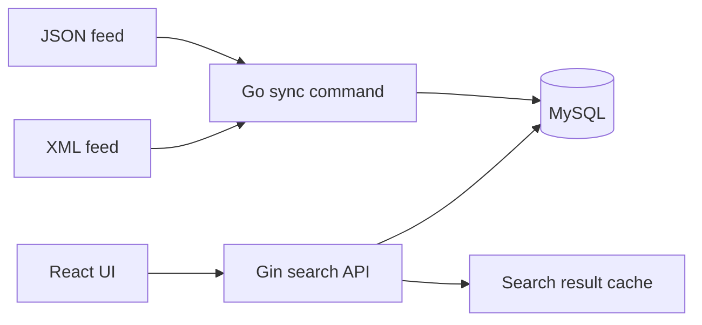

# Search Engine Service

A full-stack search engine application that aggregates content from multiple providers, ranks them by relevance score, and provides search, filtering, sorting, and pagination capabilities.

## 🏗️ Architecture

Two feeds can describe content in different formats. The sync command normalizes JSON and XML into the same MySQL schema, then calculates scores so the web client can search both feeds with one request.



### Decisions and trade-offs

- Each feed adapts its wire format to the same [Go interface](backend/internal/provider/base_provider.go). The [JSON](backend/internal/provider/json_provider.go) and [XML](backend/internal/provider/xml_provider.go) implementations parse their own responses. The [sync manager](backend/internal/provider/manager.go) calls the same fetch method for both and owns persistence. A third feed can plug into the manager once its fields map to the shared content model. A change to that model still needs review across providers.
- MySQL runs full-text title searches and falls back to a substring query for short input. This keeps ingestion and search in one database. Short substring queries can scan more rows.
- The sync command calculates ranking from provider weight, freshness and engagement. Reads can sort by a stored score, but freshness reflects the last recalculation.
- Search results have a TTL. Repeated queries can reuse results, but a cached result can lag behind the latest sync.

### Reliability and limits

The sync identifies content by provider and external ID. A later sequential sync can update an existing record. The current upsert reads before it writes, so schedule a single sync worker when using the same feeds. Content and tags are written separately. Inspect sync errors before treating a run as complete.

The backend unit suite covers parsing migration statements. The [integration workflow](.github/workflows/search.yml) starts the API against a disposable MySQL 8 database, applies the application migrations, and checks full-text search, short substring queries, filtering, ranking and pagination over HTTP. It does not establish provider availability, search throughput or safe concurrent ingestion. The Compose environment is intended for local development.

## 📁 Project Structure

```
search-engine/
├── backend/           # Go backend API
│   ├── cmd/          # Application entry points
│   │   ├── api/      # Main API server
│   │   ├── sync/     # Provider sync command
│   │   └── seed/     # Test data seeding
│   ├── internal/     # Internal packages
│   │   ├── config/   # Configuration management
│   │   ├── handler/  # HTTP handlers
│   │   ├── middleware/ # HTTP middlewares
│   │   ├── model/    # Data models
│   │   ├── provider/ # Provider integrations
│   │   ├── repository/ # Database operations
│   │   ├── scoring/  # Content scoring algorithm
│   │   └── service/  # Business logic
│   ├── migrations/   # Database migrations
│   └── docker/       # Dockerfiles
├── frontend/         # React frontend
│   ├── src/
│   │   ├── components/ # React components
│   │   ├── pages/     # Page components
│   │   ├── services/  # API services
│   │   ├── store/     # Redux store
│   │   └── utils/     # Utility functions
│   └── public/       # Static assets
└── docker-compose.yml # Multi-container orchestration
```

## 🚀 Quick Start

### Prerequisites

- Docker & Docker Compose
- Go 1.24+ (for local development)
- Node.js 20+ (for local frontend development)

### Using Docker Compose (Recommended)

1. **Clone the repository**
   ```bash
   git clone https://github.com/rezanicgil/search-engine.git
   cd search-engine
   ```

2. **Start all services with hot-reload**
   ```bash
   docker compose up -d
   ```
   
   **Hot Reload Features:**
   - ✅ Backend: Automatic rebuild and restart on Go file changes (using Air)
   - ✅ Frontend: Automatic refresh on React/JS file changes (using Vite)
   - ✅ Code changes are instantly reflected without manual restart

3. **Run database migrations** (automatic on backend startup)

4. **Sync data from providers**
   ```bash
   docker compose exec backend go run ./cmd/sync
   ```

5. **Access the application**
   - Frontend: http://localhost:3000 (with hot-reload)
   - Backend API: http://localhost:8080
   - API Docs (Swagger): http://localhost:8080/swagger/index.html
   - Health Check: http://localhost:8080/health

6. **View logs (with hot-reload output)**
   ```bash
   docker compose logs -f backend frontend
   ```

### Local Development

#### Backend

1. **Setup environment**
   ```bash
   cd backend
   cp .env.example .env
   # Edit .env with your configuration
   ```

2. **Install dependencies**
   ```bash
   go mod download
   ```

3. **Run the API**
   ```bash
   make run
   # or
   go run ./cmd/api
   ```

4. **Available commands**
   ```bash
   make build      # Build binary
   make run        # Run API locally
   make sync       # Sync providers and calculate scores
   make seed       # Add test data for pagination
   make swagger    # Generate API documentation
   make test       # Run tests
   ```

#### Frontend

1. **Install dependencies**
   ```bash
   cd frontend
   npm install
   ```

2. **Run development server**
   ```bash
   npm run dev
   ```

3. **Build for production**
   ```bash
   npm run build
   ```

## 🔧 Configuration

### Environment Variables

Copy `.env.example` to `.env` and configure:

- **Server**: `SERVER_PORT`, `SERVER_HOST`
- **Database**: `DB_HOST`, `DB_PORT`, `DB_USER`, `DB_PASSWORD`, `DB_NAME`
- **Redis**: `REDIS_ENABLED`, `REDIS_ADDR`, `REDIS_PASSWORD`, `REDIS_DB`
- **Providers**: `PROVIDER1_URL`, `PROVIDER2_URL`
- **Search**: `SEARCH_MIN_FULLTEXT_LENGTH`, `SEARCH_CACHE_TTL_SECONDS`
- **Rate Limiting**: `RATE_LIMIT_REQUESTS_PER_MINUTE`

See `backend/.env.example` for all available options.

## 📡 API Endpoints

### Search
- `GET /api/v1/search` - Search content with filtering, sorting, and pagination
  - Query params: `query`, `type`, `provider_id`, `start_date`, `end_date`, `page`, `per_page`, `sort_by`, `sort_order`

### Providers
- `GET /api/v1/providers` - Get list of all providers

### Content
- `GET /api/v1/content/:id` - Get content details by ID

### Statistics
- `GET /api/v1/stats` - Get system statistics

### Health
- `GET /health` - Health check endpoint

### Documentation
- `GET /swagger/index.html` - Swagger UI documentation

## 🎯 Features

- ✅ Multi-provider content aggregation (JSON & XML)
- ✅ Content scoring algorithm (base, freshness, engagement)
- ✅ Full-text search with LIKE fallback for short queries
- ✅ Advanced filtering (type, provider, date range)
- ✅ Sorting (score, published date, title)
- ✅ Pagination with page numbers
- ✅ Redis caching with in-memory fallback
- ✅ Redis-based distributed rate limiting (with in-memory fallback)
- ✅ CORS support
- ✅ Security headers
- ✅ Graceful shutdown
- ✅ Database migrations
- ✅ Swagger/OpenAPI documentation
- ✅ Redux state management
- ✅ Responsive UI with Tailwind CSS
- ✅ **Hot Reload** - Automatic rebuild/refresh on code changes (Backend: Air, Frontend: Vite)

## 🧪 Testing

### Backend Tests
```bash
cd backend
make test
```

### Add Test Data
```bash
cd backend
make seed  # Adds 50 test items for pagination testing
```

## 📝 Development Workflow

1. **Start services with hot-reload**: `docker compose up -d`
   - Backend automatically rebuilds on Go file changes
   - Frontend automatically refreshes on React/JS file changes

2. **Sync providers** (in a new terminal):
   ```bash
   docker compose exec backend go run ./cmd/sync
   ```

3. **Add test data** (optional):
   ```bash
   docker compose exec backend go run ./cmd/seed
   ```

4. **Develop**: 
   - Edit backend files in `backend/` - changes are automatically detected and server restarts
   - Edit frontend files in `frontend/` - changes are automatically reflected in browser
   - No manual restart needed!

5. **View logs**:
   ```bash
   docker compose logs -f backend  # Backend logs with Air output
   docker compose logs -f frontend # Frontend logs with Vite output
   ```

6. **Test**: Use Swagger UI or frontend at http://localhost:3000

## 🔒 Security Features

- Security headers (X-Frame-Options, X-Content-Type-Options, etc.)
- Rate limiting per IP
- CORS configuration
- Input validation
- SQL injection protection (parameterized queries)
- Graceful shutdown

## 📚 Documentation

- API Documentation: http://localhost:8080/swagger/index.html
- Code comments: Inline documentation throughout the codebase

## 🤝 Contributing

1. Create a feature branch
2. Make your changes
3. Ensure tests pass
4. Submit a pull request

## 📄 License

Apache 2.0

## 🐛 Troubleshooting

### Database connection issues
- Ensure MySQL container is running: `docker compose ps`
- Check environment variables in `.env`
- Verify database credentials

### Frontend not connecting to backend
- Check `VITE_API_BASE_URL` in frontend environment
- Ensure backend is running on port 8080
- Check CORS configuration

### Redis connection issues
- Redis is optional; the app falls back to in-memory cache
- Check `REDIS_ENABLED` setting
- Verify Redis container is running

## 📞 Support

For issues and questions, contact: rezanicgil@gmail.com
